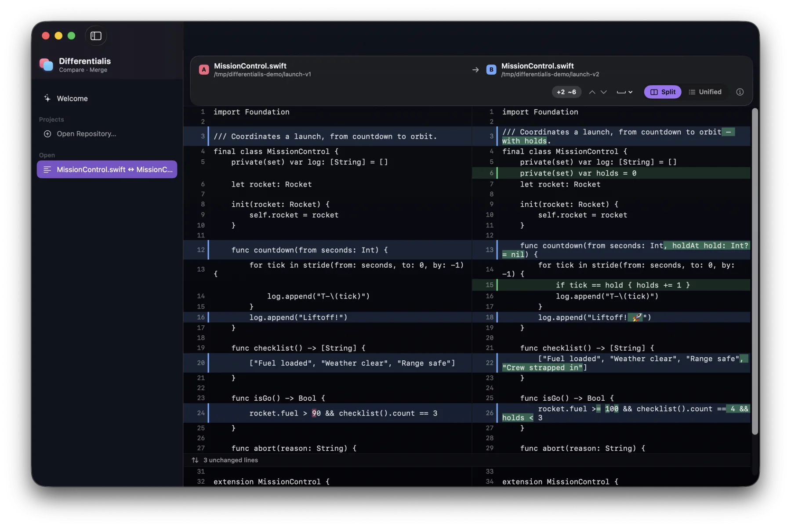
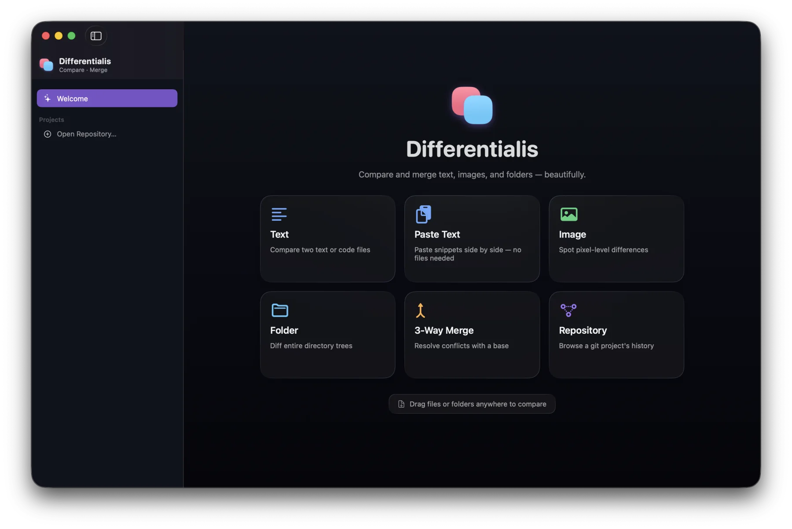
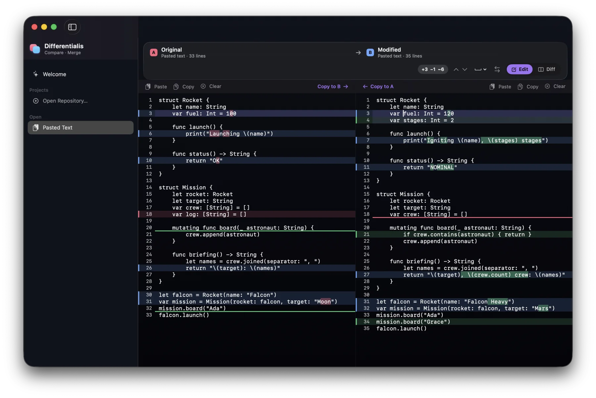
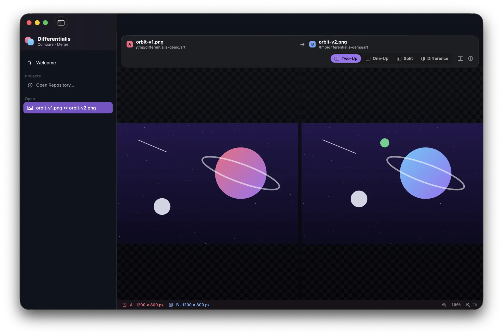
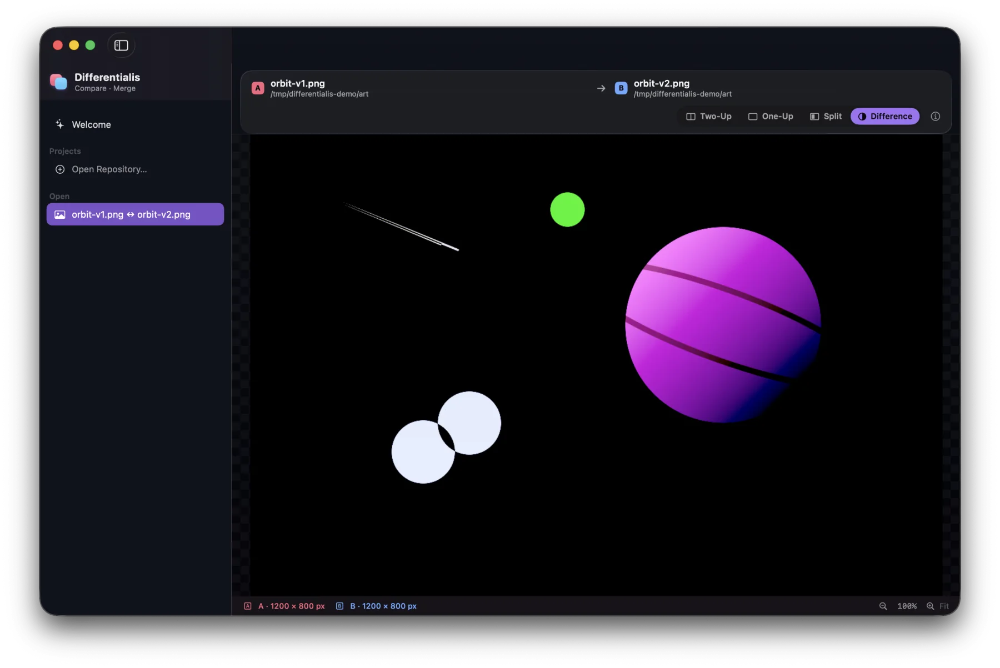
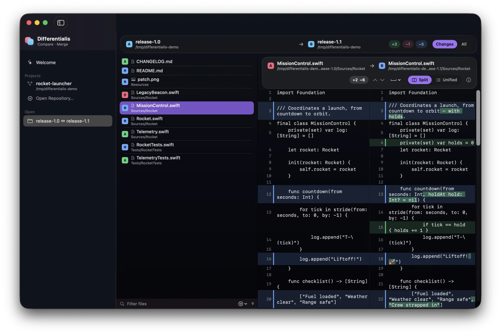
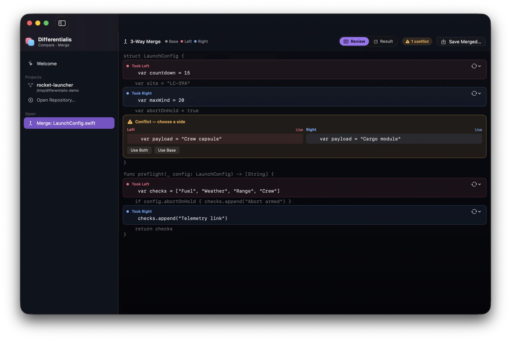
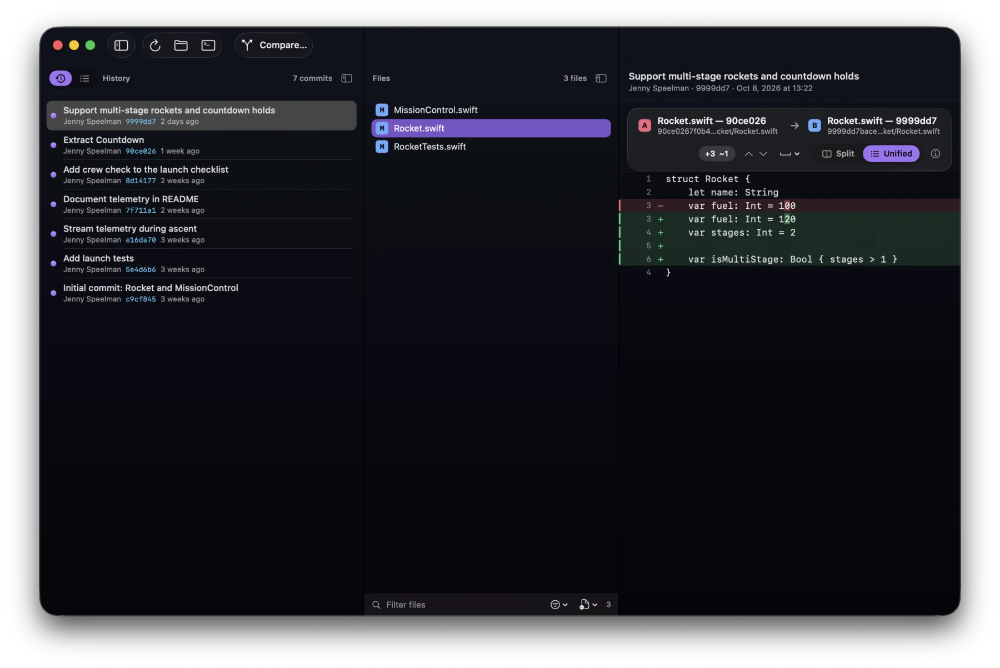
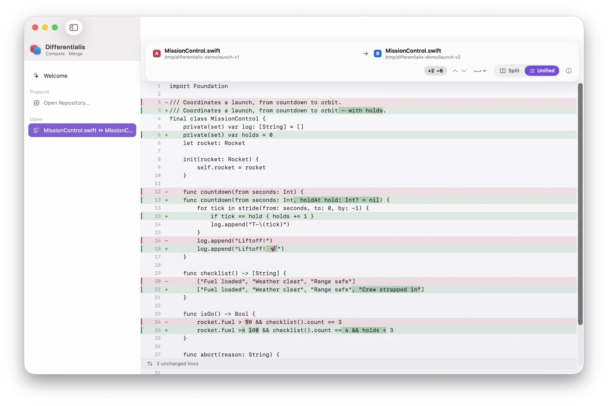

# Differentialis

[](https://github.com/yennster/differentialis/actions/workflows/ci.yml)


A free, open-source macOS app for comparing and merging text, pasted snippets, images, and folders —
with three-way merge and git built in.

**[differentialis.app](https://www.differentialis.app)** ·
[Download](https://github.com/yennster/differentialis/releases/latest) ·
[Changelog](CHANGELOG.md)

Written in SwiftUI with Apple's Liquid Glass. The diff, merge, and git engines have no
third-party dependencies; [Sparkle](https://sparkle-project.org) is the lone dependency, used
only for in-app updates.



## Download

Grab the latest **`.dmg`** from the [Releases](https://github.com/yennster/differentialis/releases)
page, open it, and drag **Differentialis** onto **Applications**.

The build is **signed with Developer ID and notarized by Apple**, so it opens without Gatekeeper
warnings. Each published release automatically gets a signed, notarized `.dmg` attached by the
[Release DMG workflow](.github/workflows/release.yml) (`macos-26` runner + Xcode 26).
Release history lives in the [changelog](CHANGELOG.md).

After that first install, you won't need the DMG again — Differentialis **updates itself**:
**Check for Updates…** (or the update banner) downloads, verifies, installs, and relaunches the
new version in place.

## Features

- **Text diff** — a from-scratch Myers diff engine with **character-level** intra-line highlights, **side-by-side and unified** layouts, exact or whitespace-insensitive matching, line-ending/final-newline diagnostics, change bars, collapsible unchanged regions, next/previous-change navigation, and live insertion/deletion stats.
- **Paste Text** — compare snippets without saving files: paste or type into two side-by-side editors (`⌘T`) and the diff updates live as you edit, with synced scrolling and line numbers. Copy any change from one side to the other (`⌥⌘→` / `⌥⌘←`), with full undo, or flip to the split/unified Diff view.

- **Image diff** — four comparison modes with `⌘1`–`⌘4`:
  - **Two-Up** (side-by-side, horizontal or vertical)
  - **One-Up** (A/B with auto-blink)
  - **Split** (draggable slider reveal)
  - **Difference** (false-color — only the changed pixels glow)
  - …with synced zoom/pan, explicit Fit/zoom controls, an accessible split divider, and a pixel-dimension readout.
- **Folder diff** — recursive scan classifying every file as **Added / Removed / Modified / Identical**, with changes-only, name, and status filters plus click-through to the right diff for each file.
- **3-way merge** — base / left / right with an editable result, per-hunk **take left / right / both / base**, content and line-ending conflict resolution, and save-merged output.
- **Git integration** — open any repository to browse its **commit history** or flip to a **changed-files** view with correct reference/index/working-tree snapshots, grouped by folder and filterable by name, extension, or status. A persistent **Projects** sidebar keeps your opened repositories one click away. Uses the system `git`, no libgit2.
- **Custom Comparison** — a Liquid Glass popover to compare **any** _Reference_ or _Commit_ (pick from history or **paste a commit hash**) against the **Working Copy**, another _Reference_, or _Commit_ — with swap, and **Save** to revisit named comparisons later.
- **Appearance & themes** — Light, Dark, or Auto (follows the system), with a theme per appearance: Differentialis, Mariana, Monokai, One Dark, Solarized, and GitHub. Build your own in the theme editor, import JSON or `.tmTheme` color schemes, and pick the code font family and size (`⌘+` / `⌘−` / `⌘0`, or pinch). All in **Settings** (`⌘,`).
- **Liquid Glass throughout** — glass toolbars, mode switchers, popovers, and panels native to macOS 26 Tahoe.
- **In-app updates** — a quiet banner (Skip / Later / **Update**) offers new versions and installs them in place — download, EdDSA-verify, swap, and relaunch — without leaving the app, plus **Check for Updates…** in the app menu. Powered by [Sparkle](https://sparkle-project.org) reading an appcast attached to the latest GitHub release.

## Screenshots

<table>
  <tr>
    <td width="50%"><br>
      <sub><b>Welcome</b> — pick a comparison, or drop files anywhere</sub></td>
    <td width="50%"><br>
      <sub><b>Paste Text</b> — live diff of pasted snippets, with per-change copy</sub></td>
  </tr>
  <tr>
    <td><br>
      <sub><b>Image diff</b> — Two-Up, One-Up, Split, and Difference</sub></td>
    <td><br>
      <sub><b>Difference mode</b> — only the changed pixels show</sub></td>
  </tr>
  <tr>
    <td><br>
      <sub><b>Folder diff</b> — added, removed, and modified files, filterable</sub></td>
    <td><br>
      <sub><b>3-way merge</b> — clean changes merge themselves; conflicts wait for you</sub></td>
  </tr>
  <tr>
    <td><br>
      <sub><b>Git</b> — history, changed files, and diffs for any commit</sub></td>
    <td><br>
      <sub><b>Light mode &amp; themes</b> — light, dark, or auto, with built-in and custom themes</sub></td>
  </tr>
</table>

## Keyboard shortcuts

Every command is in the menu bar, and **Help ▸ Keyboard Shortcuts** (`⌘/`) shows the full cheat sheet.

| Action | Shortcut |
| --- | --- |
| New Text / Image / Folder comparison | `⌘N` / `⇧⌘N` / `⌥⌘N` |
| New Pasted Text comparison | `⌘T` |
| Open Repository | `⌘O` |
| Next / previous change | `⌘]` / `⌘[` |
| Toggle Split / Unified | `⌘U` |
| Pasted text: copy change to B / A | `⌥⌘→` / `⌥⌘←` |
| Image: Two-Up / One-Up / Split / Difference | `⌘1` / `⌘2` / `⌘3` / `⌘4` |
| Code font size: bigger / smaller / reset | `⌘+` / `⌘−` / `⌘0` |
| Settings | `⌘,` |
| Go to Welcome | `⇧⌘0` |
| Keyboard Shortcuts | `⌘/` |

## Requirements

- **macOS 26 (Tahoe)** or later — the app uses the Liquid Glass APIs.
- **Xcode 26** / Swift 6.
- [XcodeGen](https://github.com/yonaskolb/XcodeGen) to generate the project: `brew install xcodegen`.

## Build & run

```bash
# 1. Generate the Xcode project from project.yml
xcodegen generate

# 2a. Open in Xcode and hit Run
open Differentialis.xcodeproj

# 2b. …or build & launch from the command line
xcodebuild -project Differentialis.xcodeproj -scheme Differentialis \
    -configuration Debug -derivedDataPath build build
open build/Build/Products/Debug/Differentialis.app
```

### Command-line launcher

A thin `differentialis` shell script is bundled inside the app and opens a diff from any
directory. Install it from the app menu: **Differentialis ▸ Install Command Line Tool…** — one
password prompt, then it's on your `$PATH` forever. (The menu item toggles to **Uninstall…**
once installed.)

Then:

```bash
differentialis <path>                       # open a git repository (error if not one)
differentialis fileA.txt fileB.txt           # compare two files (auto-detects text/image/folder)
differentialis folderA folderB               # folder diff
differentialis base.txt mine.txt theirs.txt  # 3-way merge
```

Paths are resolved against the current directory. The launcher talks to Differentialis by bundle id
(`app.differentialis.Differentialis`), so it resolves to the registered release install — not a
stale Debug build — and works whether the app is already running or not.

You can also launch straight into a comparison with `open` directly:

```bash
open Differentialis.app --args fileA.txt fileB.txt      # text or image diff
open Differentialis.app --args folderA folderB          # folder diff
open Differentialis.app --args base.txt mine.txt theirs.txt   # 3-way merge
open Differentialis.app --args /path/to/git/repo        # repository browser
```

## Architecture

```
Differentialis/
├── Diff/        Myers diff (generic), line diff, char highlights, diff3 merge — pure Swift, unit-tested
├── Git/         system-`git` wrapper (Process): log, diff, blobs, refs, changesets
├── Models/      Comparison + ComparisonSource (file / git blob / working copy), saved-comparison store
├── Features/    Text · Image · Folder · Merge · Repo views
└── DesignSystem/ Liquid Glass components, theme, the app mark
```

The diff and merge engines have **no dependencies** — `MyersDiff` powers both line- and character-level diffs, and a diff3 algorithm drives the 3-way merge. Git is driven through the system `git` binary, so there is nothing to vendor.

## Tests

```bash
xcodebuild -project Differentialis.xcodeproj -scheme Differentialis test
```

Covers Myers and line diff behavior, intra-line highlights, three-way merge, copying changes between
pasted texts, folder scanning and filtering, git status parsing, and real temporary-repository checks
for reference/index/working-tree comparisons.

[CI](.github/workflows/ci.yml) runs the same suite on a macOS 26 runner for every push to `main` and
every pull request, and checks the README and website: every local link and image resolves, and the
site's structured data, FAQ, and sitemap are valid (`python3 scripts/check-site.py` runs that check
locally).

## Roadmap

The full, prioritized backlog is in [docs/ROADMAP.md](docs/ROADMAP.md). Highlights:

- ~~A `diff`-style command-line companion~~ — shipped; see the [command-line launcher](#command-line-launcher) above. A URL scheme is still planned.
- Git mergetool / difftool auto-configuration
- PDF export of comparisons

## License

[MIT](LICENSE) © Jenny Speelman
